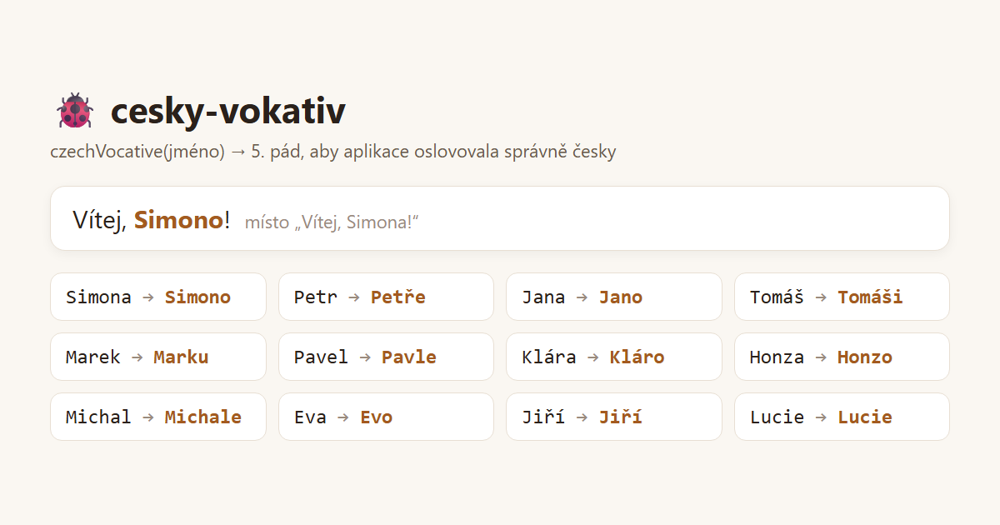

# 🐞 cesky-vokativ

Malá TypeScript utilita, která převede české **křestní jméno do 5. pádu (vokativu)** — aby aplikace mohla říct „Vítej, **Lucko**!" místo „Vítej, Lucie!".

```ts
import { czechVocative } from "cesky-vokativ";

czechVocative("Lucka");   // "Lucko"
czechVocative("Petr");    // "Petře"
czechVocative("Tomáš");   // "Tomáši"
czechVocative("Marie");   // "Marie"  ← nejistý případ, vrací 1. pád
```



## Proč to vzniklo

Psala jsem rezervační platformu, kde aplikace oslovuje uživatele jménem. Oslovení v 1. pádě („Vítej, Lucie!") působí stroze a strojově — ale čeština má vokativ **zrádný** a špatně vyskloňované jméno je horší než nevyskloňované.

Hotová řešení buď neexistovala, nebo se snažila skloňovat všechno a u méně obvyklých jmen komolila.

## Jak to funguje

Přístup je **záměrně konzervativní** — raději nesklonit než zkomolit:

1. **Slovník** běžných mužských jmen zakončených na souhlásku
   *(Petr → Petře, Marek → Marku — tady pravidlo neexistuje, je potřeba slovník)*
2. **Obecné pravidlo `-a → -o`**
   *(Jana → Jano, Lucka → Lucko, Honza → Honzo)*
3. **Všechno ostatní → 1. pád**
   *(jména na -e, -í, -o, -y a ženská na souhlásku)*

### Návrhová rozhodnutí

| Rozhodnutí | Proč |
|---|---|
| U nejistoty vrací 1. pád | Špatně vyskloňované jméno uživatele urazí; nevyskloňované ne. |
| Bere jen **první slovo** | Určeno pro křestní jméno, ne pro celé jméno nebo název firmy. |
| Prázdný vstup → prázdný řetězec | Volající nemusí ošetřovat `null`/`undefined`. |

## Omezení

- Řeší **jen křestní jména**, ne příjmení ani názvy firem
- Slovník obsahuje ~70 nejběžnějších mužských jmen — méně obvyklá zůstanou v 1. pádě
- Nerozlišuje pohlaví; rozhoduje se podle zakončení a slovníku

## Testy

```bash
npm install
npm test
```

## Licence

MIT
